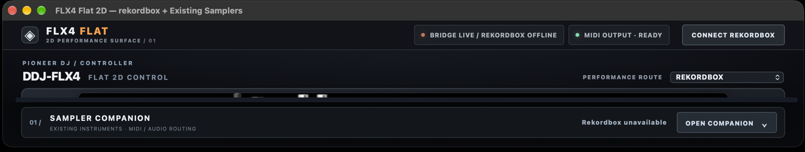
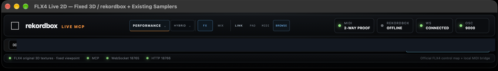
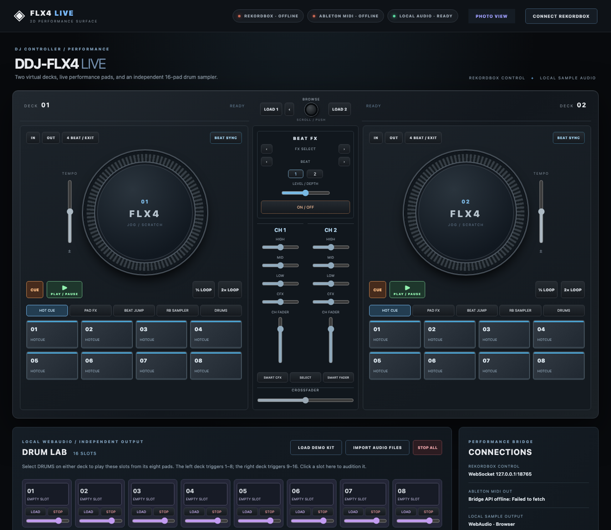

# DDJ-FLX4 Apps

Two experimental desktop control interfaces for a DDJ-FLX4-inspired workflow, including browser UI code and macOS/Python bridge source. These source snapshots document software development work; a connected physical controller and DAW are needed to validate actual routing.

## Projects

| Folder | Interface | What is available | Required for full fidelity |
| --- | --- | --- | --- |
| [`FLX4FlatDrumApp/`](FLX4FlatDrumApp/) | Flat, photo-aligned pad/drum overlay | HTML/CSS/JS controls, Swift wrapper, Python bridge and crossfader/control checks | Rights-cleared controller background art and a configured MIDI/audio environment |
| [`FLX4Live2D/`](FLX4Live2D/) | 3D and sampler-companion views | Browser scenes, control scripting, Swift wrapper and Python bridge | Rights-cleared images/textures, user-provided sounds and configured DAW/controller |

Both interfaces have been compared against their installed applications' **main authored JavaScript files**, with matching SHA-256 at the audit date. Matching scripts do not imply matching packaged assets, working hardware input or complete installed-app reproduction.

## Installed native application evidence (14 November 2026)

The installed Mac bundles were launched and the actual window surfaces captured using macOS `screencapture` by window ID. These are **cropped native application window captures**, rather than stand-in HTML mockups. The strips show only the native title bar, authored controls and status areas. Hardware photographs, third-party controller artwork and any visible local media details are covered in the public copies because redistribution rights were not established. The unaltered audit originals remain local and excluded from Git.

### Installed FLX4 Flat 2D, version 1.1.1



The app window identifies **FLX4 Flat 2D — rekordbox + Existing Samplers**. Its native UI includes performance routing and a sampler companion strip. The controller image area is intentionally concealed in this public documentation capture.

### Installed FLX4 Live 2D, version 0.3.0, fixed 3D view



The installed app's window title specifies **Fixed 3D / rekordbox + Existing Samplers**. The 3D controller panel uses withheld photographs/textures, so only the app's surrounding authored controls are shown here. Despite its name, `FLX4 Live 2D` uses a fixed camera onto a 3D scene. The available source also exposes `realistic.html` for browser rendering, while `index.html` is another browser interface; they must not be conflated with an independently installed third macOS application.

### Separate browser-only 2D performance interface (source preview)



This is a genuine Google Chrome screenshot of [`FLX4Live2D/index.html`](FLX4Live2D/index.html), rendered locally from the published HTML/CSS/JS with no external controller photos or proprietary textures. It is a **browser source preview**, not a screenshot of either installed `.app` window, and it is distinct from the fixed-camera 3D view in `realistic.html`. The browser was offline from rekordbox and Ableton, with no samples loaded. The visible WebAudio-ready indicator is only the browser interface's status display, not a test of audible playback.

The separate [`FLX4Live2D/realistic.html`](FLX4Live2D/realistic.html) 3D browser source was also launched via a local HTTP server with the withheld original textures absent. Its Three.js controller panel rendered blank; consequently, no 3D geometry image is presented as a working controller. Its 3D JavaScript contains procedural chassis, knobs, buttons, jog and fader geometry, but the standalone visual source cannot currently recreate the installed model without resolving the missing texture/model display path and redistribution rights.

**Gallery limits:** These screenshots prove the installed app windows launched and document the surrounding UI, but cannot show the original hardware rendering publicly without clarified asset rights. No connected DDJ-FLX4 hardware or working DAW playback was verified in this screenshot audit. There is no verified standalone third 3D `.app` bundle in the scanned user Applications directory.

## Explore the source

The HTML is readable without an installed app. To inspect the browser UI, serve each app directory locally:

```sh
cd FLX4FlatDrumApp/ui
python3 -m http.server 8080
# open http://127.0.0.1:8080/
```

For the second view, serve `FLX4Live2D/` similarly and open `index.html` or `realistic.html`. The missing photo and 3D texture assets mean the visual result is incomplete. Follow each project's README and bridge scripts for its hardware integration architecture; no controller driver installation is performed by the browser preview.

## Checks

```sh
node --check FLX4FlatDrumApp/ui/app.js
node FLX4FlatDrumApp/tests/test_crossfader.js
node --check FLX4Live2D/realistic3d.js
node --check FLX4Live2D/sampler-companion.js
python3 -m py_compile FLX4Live2D/bridge.py FLX4FlatDrumApp/native/FLX4LiveBridge.py
```

These checks cover source syntax and simulated crossfader behavior. Physical DDJ-FLX4 pad-to-Ableton routing, Rekordbox interoperability and end-to-end audio latency are **not verified** in this export.

## Publication and assets

This source export omits controller photographs, original 3D textures, WAV samples and generated `.app` bundles. The original hardware-backed visuals cannot be reproduced until redistributable replacements are supplied. Packaging scripts may require adapting local interpreter paths and installed dependencies. See [STATUS.md](STATUS.md) and [third-party notices](THIRD_PARTY_NOTICES.md).

DDJ-FLX4, rekordbox and Pioneer DJ/AlphaTheta marks belong to their respective owners. This community project has no official affiliation.
