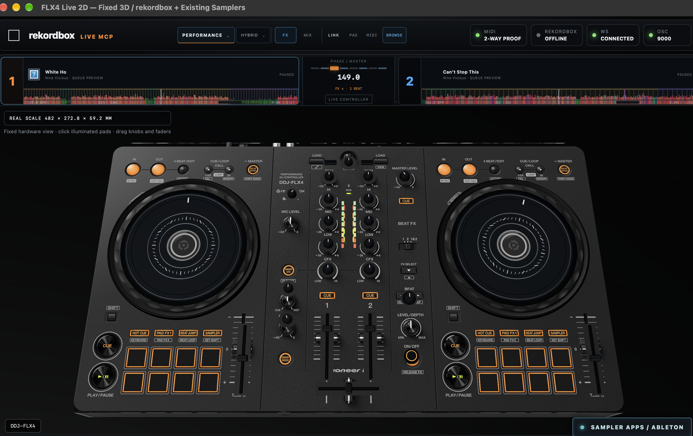
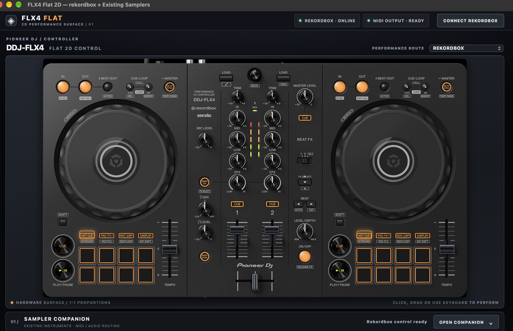

# DDJ-FLX4 emulator · two Mac applications

This repository contains the source for the **two FLX4 macOS apps shown in the screenshots below**. They are separate projects, with their own Swift window, controller interface, and local MIDI/HTTP bridge. Both were developed for an FLX4-inspired workflow with rekordbox and existing sampler applications.

These are the two **original, full-window screenshots captured on the user's Mac on November 14, 2026 at 11:16 PM**. They replace the previous redacted and source-prototype gallery. The two screenshots show the actual installed apps; they are not UI mockups or generated previews.

## 1. FLX4 Live 2D · Fixed 3D · v0.3.0



**[View the FLX4 Live 2D source](FLX4Live2D/)** · Native app: `FLX4 Live 2D.app` · Bundle: `com.mikristian.flx4live2d`

The fixed-camera **Three.js controller** has 3D depth, jog wheels, mixer controls, pads, LED feedback, two deck/track displays, and a collapsible **SAMPLER APPS / ABLETON** section. The window says “Fixed 3D” because the controller is rendered in 3D with its camera locked. This is the version pictured in the first screenshot.

The app's entry point is [`FLX4Live2D/realistic.html`](FLX4Live2D/realistic.html), driven by [`realistic3d.js`](FLX4Live2D/realistic3d.js), [`sampler-companion.js`](FLX4Live2D/sampler-companion.js), [`bridge.py`](FLX4Live2D/bridge.py), and the native [Swift window](FLX4Live2D/native/FLX4Live2D.swift). The separate `index.html` browser experiment is **not** the pictured Mac app. The source also contains a simplified asset-free `realistic.html?geometry=1` preview for development.

## 2. FLX4 Flat 2D · v1.1.1



**[View the FLX4 Flat 2D source](FLX4FlatDrumApp/)** · Native app: `FLX4 Flat 2D.app` · Bundle: `com.mikristian.flx4flat2d`

The **flat, front-facing controller** uses aligned 2D control hotspots over a controller panel, with interactive jogs, performance pads, EQ/FX controls, channel faders and crossfader. Version 1.1.1 corrected double-rendered fader handles. The UI shows the performance route, Rekordbox and MIDI states, and a collapsible sampler companion.

Its entry point is [`FLX4FlatDrumApp/ui/index.html`](FLX4FlatDrumApp/ui/index.html), with [`ui/app.js`](FLX4FlatDrumApp/ui/app.js), [`ui/style.css`](FLX4FlatDrumApp/ui/style.css), [`native/FLX4LiveBridge.py`](FLX4FlatDrumApp/native/FLX4LiveBridge.py), and the native [Swift window](FLX4FlatDrumApp/native/FLX4Flat2D.swift).

## Source and version map

| App visible above | Authoritative source folder | macOS packaging script | Captured app version |
| --- | --- | --- | --- |
| Fixed-camera 3D controller | [`FLX4Live2D/`](FLX4Live2D/) | [`native/package_mac_app.sh`](FLX4Live2D/native/package_mac_app.sh) | **0.3.0** |
| Flat 2D controller | [`FLX4FlatDrumApp/`](FLX4FlatDrumApp/) | [`native/package_flat.sh`](FLX4FlatDrumApp/native/package_flat.sh) | **1.1.1** |

The screenshot filenames and these version numbers are also checked in [`scripts/verify-release.mjs`](scripts/verify-release.mjs). Run it after any documentation or release changes:

```sh
node scripts/verify-release.mjs
node FLX4FlatDrumApp/tests/test_controls.js
node FLX4FlatDrumApp/tests/test_crossfader.js
node --check FLX4Live2D/realistic3d.js
node --check FLX4Live2D/sampler-companion.js
python3 -m unittest discover -s FLX4Live2D -p test_bridge.py
```

## Running and reproducing

On the original development Mac, these versions are installed as `~/Applications/FLX4 Live 2D.app` and `~/Applications/FLX4 Flat 2D.app`. Their source folders contain the native Swift app windows and local bridge. The corresponding native scripts build each application when the required dependencies and authorized visual assets are installed locally.

**Visual assets limitation:** The full controller photographs, branded face artwork, and original texture maps visible inside the screenshots are deliberately **not redistributed as standalone files** in this repository. Consequently, source-only builds cannot reproduce the two photographed controller surfaces exactly until equivalent authorized art is provided. For a self-contained, simplified 3D code preview, serve `FLX4Live2D/` locally and open `realistic.html?geometry=1`. The new screenshots are documentation of the actual apps; they are not substitutes for the missing source textures.

The two app screenshots do not by themselves establish that a physical DDJ-FLX4 sent control data, that rekordbox and Ableton were fully routed, or that audio was heard. Status lights depict the app UI at capture time. See the individual project READMEs for supported software operations and their hardware limitations.

## Rights and attribution

The screenshots were supplied by the app's user specifically for this GitHub gallery. They contain third-party product branding and controller visuals; publishing the screenshots does not license extraction or reuse of manufacturer artwork or music. No original songs, controller texture maps, private music library files, or generated `.app` bundles are included. See [third-party notices](THIRD_PARTY_NOTICES.md) and [publication status](STATUS.md). This project is unofficial and is not endorsed by Pioneer DJ, AlphaTheta, or rekordbox.
