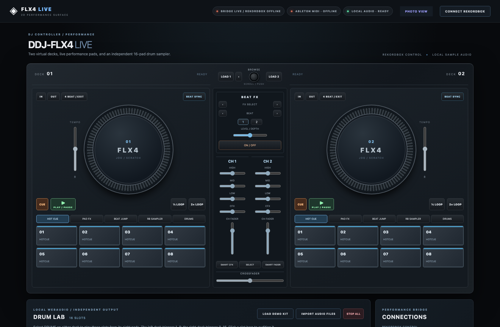
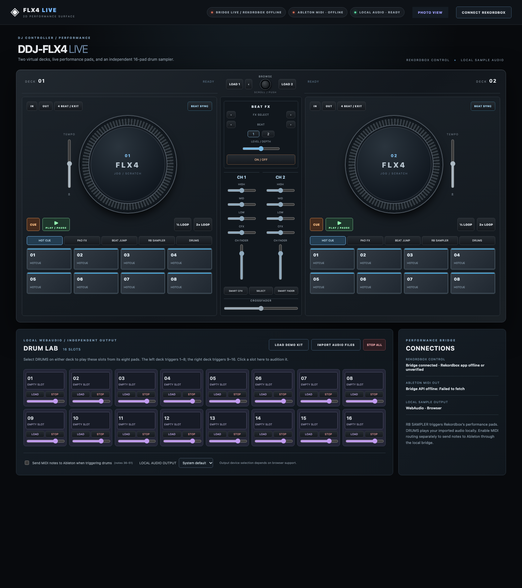
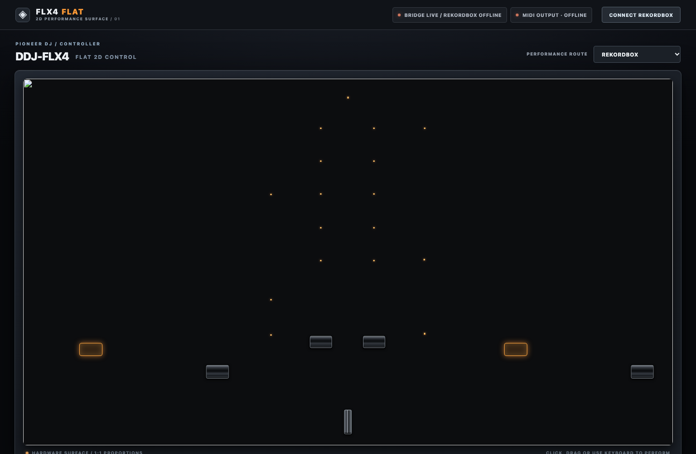
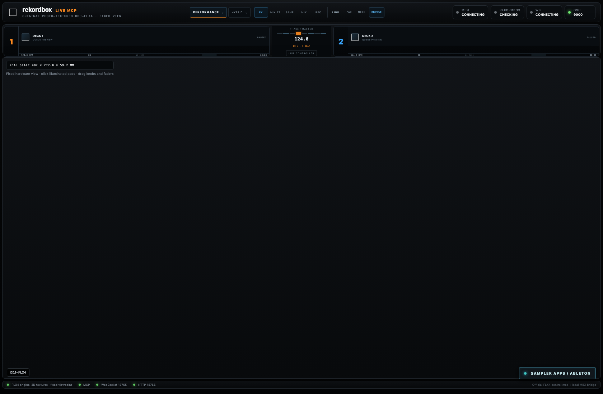

# DDJ-FLX4 Apps

Two experimental desktop control interfaces for a DDJ-FLX4-inspired workflow, including browser UI code and macOS/Python bridge source. These source snapshots document software development work; a connected physical controller and DAW are needed to validate actual routing.

## Projects

| Folder | Interface | What is available | Required for full fidelity |
| --- | --- | --- | --- |
| [`FLX4FlatDrumApp/`](FLX4FlatDrumApp/) | Flat, photo-aligned pad/drum overlay | HTML/CSS/JS controls, Swift wrapper, Python bridge and crossfader/control checks | Rights-cleared controller background art and a configured MIDI/audio environment |
| [`FLX4Live2D/`](FLX4Live2D/) | 3D and sampler-companion views | Browser scenes, control scripting, Swift wrapper and Python bridge | Rights-cleared images/textures, user-provided sounds and configured DAW/controller |

Both interfaces have been compared against their installed applications' **main authored JavaScript files**, with matching SHA-256 at the audit date. Matching scripts do not imply matching packaged assets, working hardware input or complete installed-app reproduction.

## Interface gallery (actual staged browser captures)

### FLX4 LIVE 2D performance surface



### FLX4 LIVE drum lab and bridge status



The above screenshots show the **actual staged `FLX4Live2D/index.html` interface** rendered by headless Google Chrome on November 14, 2026, with no external samples or connected controller. The visible 'bridge live' indicator is the interface's own local bridge state; it does **not** establish communication with Rekordbox, Ableton or physical hardware. Empty drum pads are intentional.

### Flat 2D controller overlay



This is an **actual screenshot of the staged Flat 2D HTML/CSS/JS interface** in an offline/disconnected state. The large black region is intentional: the original product photograph/background has been excluded for redistribution rights, leaving only the independently authored control overlays. It is not a screenshot of the complete installed native app and does not demonstrate connected hardware or audio playback.

### Optional photo/3D fixed-view shell (restricted asset omitted)



This screenshot captures the actual `FLX4Live2D/realistic.html` shell. Its central controller region remains blank because the original licensed photographs, 3D model textures and complete runtime dependencies are omitted. It is **not** a working 3D controller demonstration. For the functional source-based browser layout, see the performance surface gallery above.

## Explore the source

The HTML is readable without an installed app. To inspect the browser UI, serve each app directory locally:

```sh
cd FLX4FlatDrumApp/ui
python3 -m http.server 8080
# open http://127.0.0.1:8080/
```

For the second view, serve `FLX4Live2D/` similarly and open `index.html` or `realistic.html`. The missing photo and 3D texture assets mean the visual result is incomplete. Follow each project's README and bridge scripts for its hardware integration architecture; no controller driver installation is performed by the browser preview.

## Checks

```sh
node --check FLX4FlatDrumApp/ui/app.js
node FLX4FlatDrumApp/tests/test_crossfader.js
node --check FLX4Live2D/realistic3d.js
node --check FLX4Live2D/sampler-companion.js
python3 -m py_compile FLX4Live2D/bridge.py FLX4FlatDrumApp/native/FLX4LiveBridge.py
```

These checks cover source syntax and simulated crossfader behavior. Physical DDJ-FLX4 pad-to-Ableton routing, Rekordbox interoperability and end-to-end audio latency are **not verified** in this export.

## Publication and assets

This source export omits controller photographs, original 3D textures, WAV samples and generated `.app` bundles. The original hardware-backed visuals cannot be reproduced until redistributable replacements are supplied. Packaging scripts may require adapting local interpreter paths and installed dependencies. See [STATUS.md](STATUS.md) and [third-party notices](THIRD_PARTY_NOTICES.md).

DDJ-FLX4, rekordbox and Pioneer DJ/AlphaTheta marks belong to their respective owners. This community project has no official affiliation.
